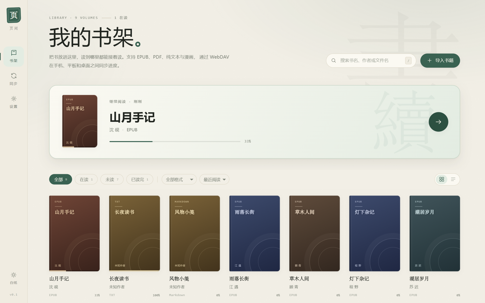
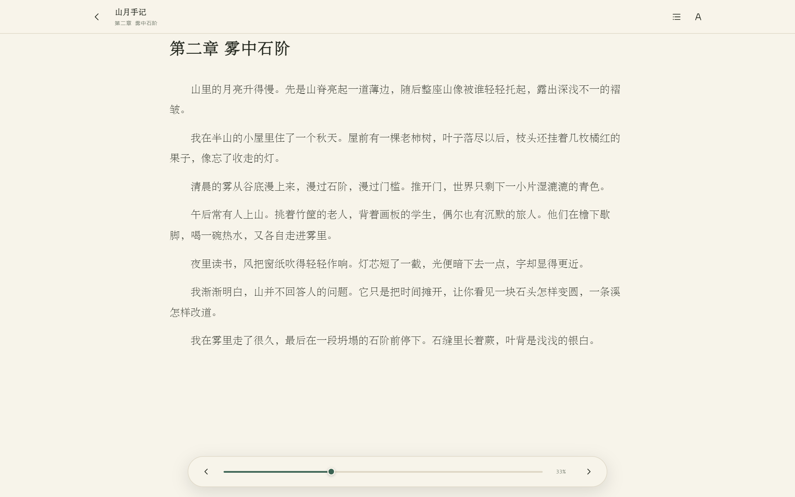
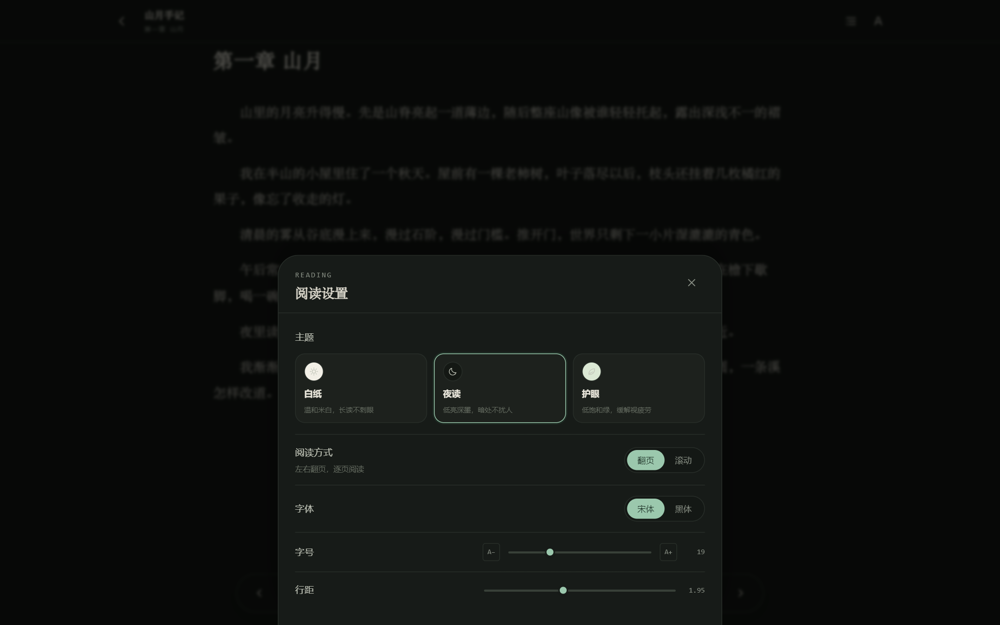
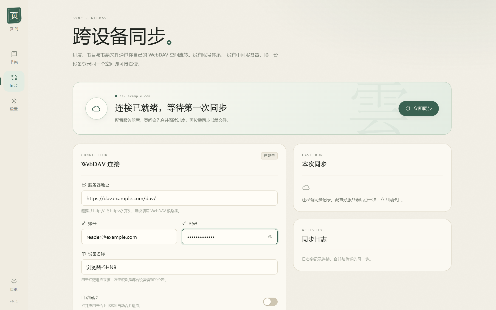
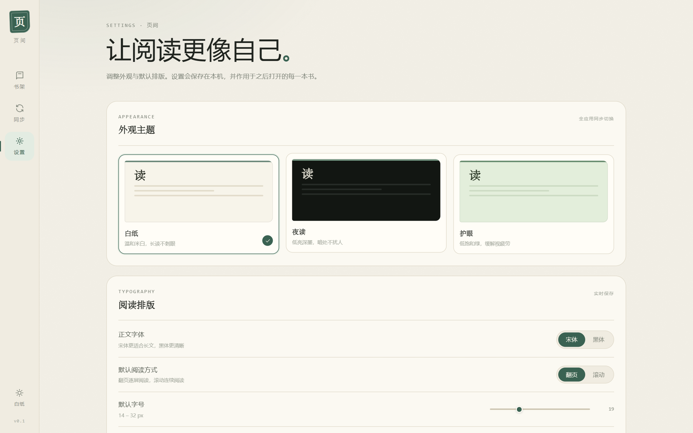
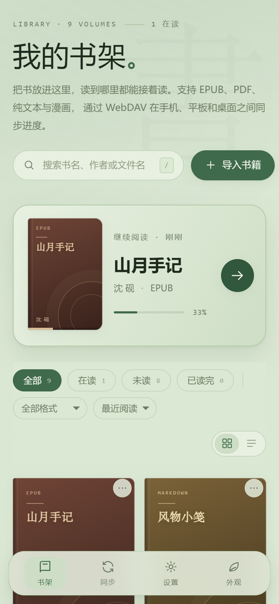
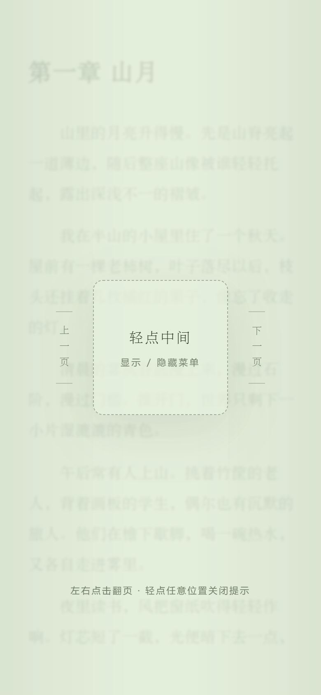

# Yejian (页间)

[简体中文](README.md) | English

[](LICENSE)
[](https://vuejs.org/)
[](https://vite.dev/)
[](https://www.typescriptlang.org/)
[](https://www.electronjs.org/)
[](https://uniapp.dcloud.net.cn/)

> A local-first, cross-device reader. Your library, books and reading progress stay on your devices and your own WebDAV space — no accounts, no middle server.

Yejian runs on **Web / Windows / Android**: open it in a browser, package it with Electron, or ship the same reading core through a uni-app Android shell. All parsing is local; network access only happens through the WebDAV sync you configure.

## Screenshots

### Desktop

<p align="center">
  
  
</p>
<p align="center">
  
  
</p>
<p align="center">
  
</p>

### Mobile

<p align="center">
  
  
</p>

> Screenshots use demo books and placeholder credentials; no real books or secrets are included.

## Features

- **Broad format support**: open EPUB, PDF, TXT, Markdown, RTF, FB2, HTML/XHTML/XML/MHTML, CBZ/CBT and DOCX directly. Kindle, CHM, DjVu, OFD and CAJ files are detected with conversion guidance.
- **Two reading modes**: paginated or continuous scrolling for text, EPUB, PDF and comics, preserving your position when switching.
- **Deliberate gestures**: tap the left/right side to turn pages, tap the central square to toggle the toolbars, with a one-time tap-zone guide.
- **Three themes**: paper, night and a green eye-comfort theme across the reader, TOC and settings.
- **Typography controls**: font size, line height, measure, serif/sans; PDF night inversion and eye-comfort filter; single/double-page comics.
- **Progress that survives**: IndexedDB persistence on page turns, exits and reloads; reading resumes where you left off.
- **WebDAV sync**: library metadata, reading progress and book files; progress merges by `updatedAt` so every device continues at the right place.
- **Desktop and mobile shells**: Electron and uni-app Android share the same built assets.

## Format support

| Category | Native | Conversion required |
| --- | --- | --- |
| E-books | EPUB, PDF, FB2 | MOBI, AZW, AZW3 → EPUB |
| Plain text | TXT, Markdown, RTF | — |
| Web | HTML, HTM, XHTML, XML, MHTML, MHT | CHM → EPUB / HTML |
| Comics | CBZ, CBT | CBR, CB7 → CBZ |
| Documents | DOCX | DOC, PPT, PPTX, XPS, OXPS, DjVu, DJV, OFD → PDF / DOCX |
| Academic | — | CAJ → PDF (guidance shown on import) |

> Suggested converters: Calibre (MOBI/AZW3/CHM), 7-Zip (CBR/CB7/CHM), DjVuLibre, CAJViewer, WPS/Office. Yejian does not bundle converters and never uploads your files.

## Download

Grab the latest build from [Releases](https://github.com/itcwc/yejian-reader/releases):

- **Windows**: `yejian-v0.1.19-windows-x64.exe` (NSIS installer; the installed app is named 页间阅读)
- **Android**: `yejian-v0.1.19-android-debug.apk` (debug-signed, sideload after allowing unknown sources)

The APK is built in CI with a native WebView shell and includes the full offline reader. To ship your own package name, signing key or store listing, import `android-uniapp` in HBuilderX and build it yourself.

### In-app updates

- **Windows**: checks GitHub Releases shortly after launch, shows a corner prompt on a new version, downloads it in-app and installs on restart. You can also check manually in Settings → About.
- **Android**: reads `update.json` on launch, compares versions, downloads the APK, verifies its SHA-256 and hands it to the system installer for an in-place update.

> Android builds before v0.1.1 used an ephemeral CI key, so they cannot be updated in place — uninstall the old app once before installing v0.1.1.

## Getting started

Requires Node.js 18+.

```bash
npm install
npm run dev          # web dev server at http://localhost:5180
```

```bash
npm run build        # static web build in dist/
npm run preview      # preview build (includes the WebDAV same-origin proxy)
```

### Windows desktop

```bash
npm run pc           # build and launch with Electron
npm run build:pc     # package the installer into release/
```

If the Electron binary was skipped during install, run `npm rebuild electron`.

### Android

```bash
npm run build:android   # build and copy assets into both Android shells
```

- **Install directly**: download the CI-built debug APK from Releases.
- **Build your own**: import `android-uniapp` in HBuilderX, set your app name, package id and signing, then build.
- **CI APK**: `android-webview` is a native WebView shell that `.github/workflows/release.yml` builds with the Android SDK and uploads to the release.

## Transfer your library and reading progress offline

On the old device, go to Settings → Library and progress backup and export a backup. Copy the `.yejianbackup` file to the new device and import it from the same screen. The backup contains the original books, covers, and reading positions. Import adds missing books and keeps the most recently updated reading position for each book.

## WebDAV setup

Open the Sync page and fill in:

| Field | Example |
| --- | --- |
| Server URL | `https://dav.jianguoyun.com/dav/` |
| Username | your account |
| Password | app-specific password |
| Device name | labels where progress comes from |

- Run **Test connection** first, then **Sync now**.
- Enable **Sync book files** to upload the books themselves; otherwise only metadata and progress are synced.
- Remote layout: `yejian/books.json`, `yejian/progress.json`, `yejian/books/<id>.<ext>`.

### CORS

Browsers require the WebDAV server to allow cross-origin `PROPFIND`, `MKCOL` and `PUT`. `npm run dev` and `npm run preview` ship a same-origin `/__dav` proxy that bypasses CORS automatically. The desktop app (Electron) and Android app use native HTTP requests and do not need server-side CORS; only static web deployments require CORS or a reverse proxy.

For a self-hosted Nginx WebDAV:

```nginx
location ^~ /dav/ {
    alias /www/wwwroot/your-site/dav/;   # keep trailing slashes on both sides
    dav_methods PUT DELETE MKCOL COPY MOVE;
    dav_ext_methods PROPFIND OPTIONS;    # requires nginx-dav-ext-module
    create_full_put_path on;
    dav_access user:rw group:rw all:r;
    client_max_body_size 0;
}
```

The directory must be writable by the Nginx user (e.g. `www`), otherwise `MKCOL` fails.

## Project structure

```
src/
  core/          # IndexedDB, format registry, metadata/covers, parsers, WebDAV, sync
  readers/       # EPUB / PDF / flow-text / comic / HTML engines
  views/         # library, reader, sync, settings
  components/    # book cover, rail, mobile nav, modal, toast
  stores/        # Pinia: library, preferences, sync, toasts
  styles/        # theme tokens and base styles
electron/        # desktop main process and preload
android-uniapp/  # uni-app shell for HBuilderX builds
android-webview/ # native WebView shell used by CI to produce the APK
scripts/         # copy build output into the Android hybrid folders
```

Data lives in IndexedDB (`yejian`) with `books`, `files`, `covers` and `progress` stores. A book fingerprint is the SHA-256 of its first 1 MB plus file size, stable across devices, used to deduplicate imports and match remote files.

Sync order: read the remote manifest → download missing books → merge progress (newest `updatedAt` wins) → write back manifest and progress. Downloading before merging ensures progress lands on books a new device just fetched.

## Keyboard shortcuts

| Key | Action |
| --- | --- |
| `←` / `→` / `↑` / `↓` | Previous / next page (scroll in continuous mode) |
| `PageUp` / `PageDown` / `Space` | Page turn |
| `T` | Toggle table of contents |
| `S` | Toggle typography settings |
| `Esc` | Close panels |

## Known limitations

- Conversion-required formats only get guidance; CAJ must be exported to PDF with CAJViewer first.
- Direct browser WebDAV access is subject to CORS; static deployments need server-side support, while the desktop and Android apps do not.
- Very large PDFs/comics take time to decode on first open; PDF scroll mode renders lazily by viewport.
- DRM-protected EPUB/PDF files are not supported.

## Contributing

Issues and pull requests are welcome. Please make sure `npm run build` passes and include reproduction steps plus the file format involved (no copyrighted content needed).

## License

[MIT](LICENSE) © 2026 Yejian Contributors
