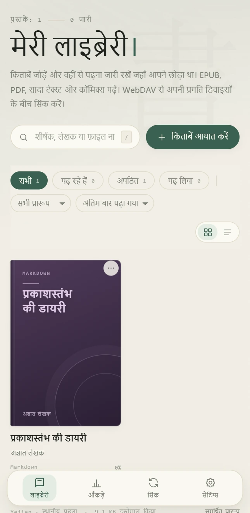
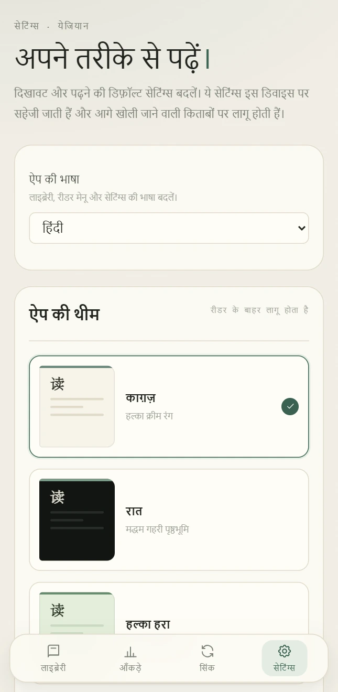

# येजियान (页间)

[简体中文](README.zh-CN.md) | **हिंदी** | [Português](README.pt.md) | [Indonesian](README.id.md) | [English](README.md) | [Türkçe](README.tr.md)

[परियोजना की वेबसाइट](https://itcwc.github.io/yejian-reader/?lang=hi) · [नवीनतम रिलीज़](https://github.com/itcwc/yejian-reader/releases/latest)

येजियान एक मुफ़्त, ओपन-सोर्स रीडर है जो स्थानीय फ़ाइलों के साथ काम करता है। आप बिना खाता बनाए ऑफ़लाइन पढ़ सकते हैं और चाहें तो अपने WebDAV सर्वर से किताबें और पढ़ने की प्रगति सिंक कर सकते हैं।

## स्क्रीनशॉट

Android ऐप पहली बार खोलने पर भाषा चुनें। बाद में इसे **सेटिंग्स → ऐप की भाषा** में बदल सकते हैं।

<p align="center">
  
  
  
</p>

## सुविधाएँ

- EPUB, PDF, TXT, Markdown, RTF, FB2, HTML, DOCX और CBZ/CBT सीधे खोलें।
- पन्ने पलटकर या लगातार स्क्रॉल करके पढ़ें। फ़ॉन्ट, लाइन स्पेसिंग और टेक्स्ट की चौड़ाई बदलें।
- पेपर, नाइट और हल्के हरे थीम में से चुनें। रीडर आपकी पढ़ने की जगह याद रखता है।
- किताबों, कवर और प्रगति का स्थानीय बैकअप निर्यात करें या WebDAV से सिंक करें।

## समर्थित फ़ॉर्मैट

| श्रेणी | सीधे खोलें | बदलना ज़रूरी |
| --- | --- | --- |
| ई-पुस्तकें | EPUB, PDF, FB2 | MOBI, AZW, AZW3 → EPUB |
| सादा टेक्स्ट | TXT, Markdown, RTF | — |
| वेब | HTML, HTM, XHTML, XML, MHTML, MHT | CHM → EPUB / HTML |
| कॉमिक्स | CBZ, CBT | CBR, CB7 → CBZ |
| दस्तावेज़ | DOCX | DOC, PPT, PPTX, XPS, OXPS, DjVu, DJV, OFD → PDF / DOCX |
| शैक्षणिक | — | CAJ → PDF (आयात करते समय निर्देश दिखते हैं) |

फ़ॉर्मैट बदलने के लिए Calibre, 7-Zip, DjVuLibre, CAJViewer या WPS/Office इस्तेमाल करें। (Calibre (MOBI/AZW3/CHM), 7-Zip (CBR/CB7/CHM), DjVuLibre, CAJViewer, WPS/Office).

## डाउनलोड और इंस्टॉलेशन

[नवीनतम रिलीज़](https://github.com/itcwc/yejian-reader/releases/latest) से अपने डिवाइस के लिए फ़ाइल डाउनलोड करें।

- **Windows** — 64-बिट `.exe`। इंस्टॉलेशन शुरू होने से पहले हिंदी सहित छह भाषाओं में से चुनें।
- **Android** — Android 7.0 या बाद के संस्करण के लिए हस्ताक्षरित `.apk`। इंस्टॉलेशन स्क्रीन फ़ोन की सिस्टम भाषा इस्तेमाल करती है।

पुराने डीबग APK से नए हस्ताक्षरित संस्करण पर जाने के लिए, पहले पुराने ऐप में **सेटिंग्स → लाइब्रेरी और पढ़ने की प्रगति का बैकअप → निर्यात** (设置 → 书库与进度备份 → 导出备份) खोलें। `.yejianbackup` फ़ाइल को Downloads या क्लाउड में सुरक्षित करें। फिर पुराना ऐप हटाएँ, नया APK इंस्टॉल करें और उसी पैनल से बैकअप आयात करें। ऐप की सेटिंग्स और WebDAV दोबारा सेट करें। [विस्तृत निर्देश](.github/release-notes/v0.1.21.md)

### ऐप में अपडेट

Windows और Android ऐप लॉन्च पर अपडेट जाँचते हैं। उपलब्ध अपडेट ऐप से डाउनलोड करें। Windows पर इंस्टॉल पूरा करने के लिए ऐप फिर खोलें। Android डाउनलोड का SHA-256 जाँचकर सिस्टम इंस्टॉलर खोलता है।

## वेब संस्करण चलाएँ

[ब्राउज़र में येजियान खोलें](https://itcwc.github.io/yejian-reader/app/?lang=hi), या Node.js 18+ के साथ रिपॉज़िटरी की मुख्य डायरेक्टरी में चलाएँ:

```bash
npm install
npm run dev
```

`http://localhost:5180` खोलें। प्रोडक्शन बिल्ड बनाने और स्थानीय रूप से जाँचने के लिए:

```bash
npm run build
npm run preview
```

### वेब पर डिप्लॉय करें

`npm run build` के बाद `dist/` की सामग्री अपने स्टैटिक वेब होस्ट पर अपलोड करें। इस रिपॉज़िटरी में [GitHub Pages वर्कफ़्लो](.github/workflows/pages.yml) प्रचार पृष्ठ और वेब रीडर को साथ प्रकाशित करता है। ब्राउज़र से WebDAV सिंक करने के लिए सर्वर पर CORS की अनुमति दें या उसी ओरिजिन पर रिवर्स प्रॉक्सी लगाएँ। `npm run dev` और `npm run preview` में स्थानीय `/__dav` प्रॉक्सी शामिल है।

### Windows x64 पैकेज

```bash
npm run pc
npm run build:pc
```

पहला कमांड Electron में ऐप खोलता है। दूसरा `release/` में x64 इंस्टॉलर बनाता है। अगर Electron डाउनलोड नहीं हुआ, तो `npm rebuild electron` चलाएँ।

### Android पैकेज

```bash
npm run build:android
```

यह कमांड वेब बिल्ड को दोनों Android शेल में कॉपी करता है। अपने पैकेज के लिए `android-uniapp` को HBuilderX में आयात करें और ऐप का नाम, पैकेज आईडी और हस्ताक्षर सेट करें। [रिलीज़ वर्कफ़्लो](.github/workflows/release.yml) Android SDK और Gradle से `android-webview` का हस्ताक्षरित APK बनाता है।

### WebDAV

**सिंक** पृष्ठ पर सर्वर का URL, उपयोगकर्ता नाम, ऐप पासवर्ड और डिवाइस का नाम भरें। पहले कनेक्शन की जाँच करें, फिर सिंक चलाएँ। किताबों की फ़ाइलें भी भेजनी हैं तो उस विकल्प को चालू करें। ब्राउज़र का WebDAV सर्वर `PROPFIND`, `MKCOL` और `PUT` की अनुमति दे।

सर्वर पर डेटा की जगह: `yejian/books.json`, `yejian/progress.json`, `yejian/books/<id>.<ext>`.

### Nginx WebDAV उदाहरण

अपने Nginx सर्वर पर WebDAV के लिए यह उदाहरण इस्तेमाल करें।

```nginx
location ^~ /dav/ {
    alias /www/wwwroot/your-site/dav/;
    dav_methods PUT DELETE MKCOL COPY MOVE;
    dav_ext_methods PROPFIND OPTIONS;
    create_full_put_path on;
    dav_access user:rw group:rw all:r;
    client_max_body_size 0;
}
```

दोनों पथों के अंत में स्लैश रखें। `PROPFIND` के लिए `nginx-dav-ext-module` चाहिए। Nginx चलाने वाले उपयोगकर्ता को इस डायरेक्टरी में लिखने की अनुमति दें। यह उदाहरण WebDAV स्टोरेज के लिए है। अलग ऑरिजिन से पहुँचने वाले वेब रीडर के लिए CORS कॉन्फ़िगर करें।

## लाइब्रेरी और पढ़ने की प्रगति का ऑफ़लाइन स्थानांतरण

पुराने डिवाइस पर **सेटिंग्स → लाइब्रेरी और पढ़ने की प्रगति का बैकअप → निर्यात** चुनें। `.yejianbackup` फ़ाइल नए डिवाइस पर कॉपी करें और उसी पैनल से आयात करें। इसमें मूल किताबें, कवर और पढ़ने की जगह शामिल हैं। आयात में छूटी हुई किताबें जुड़ती हैं और हर किताब की सबसे हाल की प्रगति रखी जाती है।

## कीबोर्ड शॉर्टकट

| कुंजी | काम |
| --- | --- |
| `←` / `→` / `↑` / `↓` | पिछला या अगला पन्ना (लगातार मोड में स्क्रॉल) |
| `PageUp` / `PageDown` / `Space` | पन्ना पलटें |
| `T` | विषय-सूची दिखाएँ या छिपाएँ |
| `S` | टाइपोग्राफ़ी सेटिंग्स दिखाएँ या छिपाएँ |
| `Esc` | पैनल बंद करें |

## प्रोजेक्ट की संरचना

`src` में वेब इंटरफ़ेस और रीडर हैं। `electron` डेस्कटॉप ऐप है। `android-webview` रिलीज़ APK के लिए है और `android-uniapp` HBuilderX के लिए। डेटा IndexedDB में रहता है। WebDAV सिंक पहले गायब किताबें डाउनलोड करता है, फिर सबसे हाल की पढ़ने की जगह मिलाता है।

## सीमाएँ

कुछ फ़ॉर्मैट पहले बदलने पड़ते हैं। CAJ को CAJViewer से PDF में निर्यात करें। बड़ी PDF और कॉमिक्स पहली बार खोलने में समय ले सकती हैं। DRM-सुरक्षित EPUB और PDF समर्थित नहीं हैं।

## योगदान

समस्याएँ और पुल रिक्वेस्ट स्वागत योग्य हैं। `npm run build` चलाएँ और समस्या को दोहराने के चरण व फ़ाइल फ़ॉर्मैट बताएं।

## लाइसेंस

[MIT लाइसेंस](LICENSE) · [समस्या की रिपोर्ट करें](https://github.com/itcwc/yejian-reader/issues)
