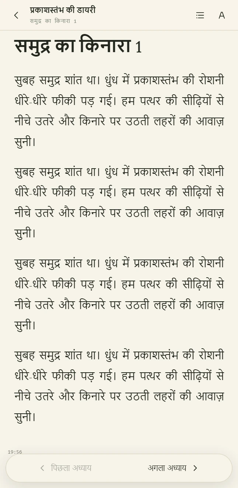

# येजियान (页间)

[简体中文](README.zh-CN.md) | **हिंदी** | [Português](README.pt.md) | [Indonesian](README.id.md) | [English](README.md) | [Türkçe](README.tr.md)

[परियोजना की वेबसाइट](https://itcwc.github.io/yejian-reader/?lang=hi) · [नवीनतम रिलीज़](https://github.com/itcwc/yejian-reader/releases/latest)

येजियान एक मुफ़्त, ओपन-सोर्स रीडर है जो स्थानीय फ़ाइलों के साथ काम करता है। आप बिना खाता बनाए ऑफ़लाइन पढ़ सकते हैं और चाहें तो अपने WebDAV सर्वर से किताबें और पढ़ने की प्रगति सिंक कर सकते हैं।

## स्क्रीनशॉट

Android ऐप पहली बार खोलने पर भाषा चुनें। बाद में इसे **सेटिंग्स → ऐप की भाषा** में बदल सकते हैं।

  
  
  

## सुविधाएँ

- EPUB, PDF, TXT, Markdown, RTF, FB2, HTML, DOCX और CBZ/CBT सीधे खोलें।
- पन्ने पलटकर या लगातार स्क्रॉल करके पढ़ें। फ़ॉन्ट, लाइन स्पेसिंग और टेक्स्ट की चौड़ाई बदलें।
- पेपर, नाइट और हल्के हरे थीम में से चुनें। रीडर आपकी पढ़ने की जगह याद रखता है।
- किताबों, कवर और प्रगति का स्थानीय बैकअप निर्यात करें या WebDAV से सिंक करें।

## डाउनलोड और इंस्टॉलेशन

[नवीनतम रिलीज़](https://github.com/itcwc/yejian-reader/releases/latest) से अपने डिवाइस के लिए फ़ाइल डाउनलोड करें।

- **Windows** — 64-बिट `.exe`। इंस्टॉलेशन शुरू होने से पहले हिंदी सहित छह भाषाओं में से चुनें।
- **Android** — Android 7.0 या बाद के संस्करण के लिए हस्ताक्षरित `.apk`। इंस्टॉलेशन स्क्रीन फ़ोन की सिस्टम भाषा इस्तेमाल करती है।

पुराने डीबग APK से नए हस्ताक्षरित संस्करण पर जाने के लिए, पहले पुराने ऐप में **सेटिंग्स → लाइब्रेरी और पढ़ने की प्रगति का बैकअप → निर्यात** (设置 → 书库与进度备份 → 导出备份) खोलें। `.yejianbackup` फ़ाइल को Downloads या क्लाउड में सुरक्षित करें। फिर पुराना ऐप हटाएँ, नया APK इंस्टॉल करें और उसी पैनल से बैकअप आयात करें। ऐप की सेटिंग्स और WebDAV दोबारा सेट करें। [विस्तृत निर्देश](.github/release-notes/v0.1.21.md)

## विकास और लाइसेंस

Node.js 18+ के साथ `npm install` और `npm run dev` चलाएँ। प्रोडक्शन बिल्ड के लिए `npm run build` इस्तेमाल करें। कुछ फ़ॉर्मैट को पहले बदलना पड़ता है और DRM-सुरक्षित फ़ाइलें समर्थित नहीं हैं। अधिक जानकारी के लिए [अंग्रेज़ी दस्तावेज़](README.md) देखें।

[MIT लाइसेंस](LICENSE) · [समस्या की रिपोर्ट करें](https://github.com/itcwc/yejian-reader/issues)
