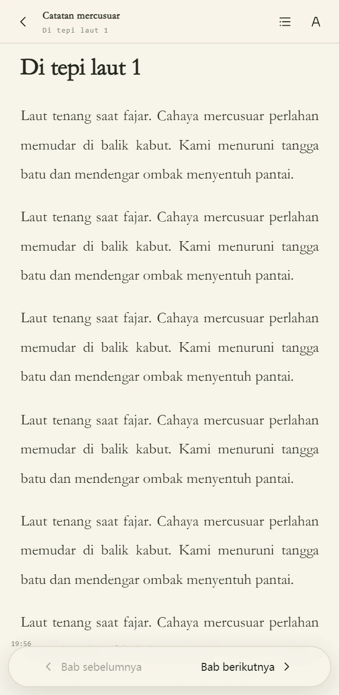

# Yejian (页间)

[简体中文](README.zh-CN.md) | [हिंदी](README.hi.md) | [Português](README.pt.md) | **Indonesian** | [English](README.md) | [Türkçe](README.tr.md)

[Situs proyek](https://itcwc.github.io/yejian-reader/?lang=id) · [Rilis terbaru](https://github.com/itcwc/yejian-reader/releases/latest)

Yejian adalah aplikasi baca gratis dan bersumber terbuka yang menyimpan pustaka di perangkat. Baca secara luring tanpa akun, atau gunakan server WebDAV sendiri untuk menyinkronkan buku dan progres membaca.

## Tangkapan layar

Saat pertama membuka aplikasi Android, pilih bahasa. Anda dapat mengubahnya di **Pengaturan → Bahasa aplikasi**.

  
  
  

## Fitur

- Buka EPUB, PDF, TXT, Markdown, RTF, FB2, HTML, DOCX, dan CBZ/CBT secara langsung.
- Baca per halaman atau gulir terus-menerus. Atur jenis dan ukuran huruf, spasi baris, serta lebar teks.
- Pilih tema kertas, malam, atau hijau lembut. Posisi baca terakhir tersimpan di perangkat.
- Ekspor cadangan buku, sampul, dan progres, atau sinkronkan melalui WebDAV.

## Unduh dan pasang

Pilih berkas perangkat Anda di halaman [rilis terbaru](https://github.com/itcwc/yejian-reader/releases/latest).

- **Windows** — pemasang `.exe` 64-bit. Pilih bahasa Indonesia atau salah satu dari enam bahasa sebelum pemasangan dimulai.
- **Android** — `.apk` bertanda tangan untuk Android 7.0 atau yang lebih baru. Layar pemasangan mengikuti bahasa sistem ponsel.

Untuk beralih dari APK debug, buka **Pengaturan → Cadangan pustaka dan progres → Ekspor** (设置 → 书库与进度备份 → 导出备份) di aplikasi lama. Simpan berkas `.yejianbackup` di folder Unduhan atau penyimpanan awan. Hapus aplikasi lama, pasang APK baru, lalu impor cadangan dari panel yang sama. Atur ulang preferensi aplikasi dan WebDAV. [Panduan migrasi](.github/release-notes/v0.1.21.md)

## Pengembangan dan lisensi

Gunakan Node.js 18 atau lebih baru, lalu jalankan `npm install` dan `npm run dev`. Untuk build produksi, jalankan `npm run build`. Beberapa format memerlukan konversi dan berkas berpelindung DRM tidak didukung. Lihat [dokumentasi bahasa Inggris](README.md) untuk detailnya.

[Lisensi MIT](LICENSE) · [Laporkan masalah](https://github.com/itcwc/yejian-reader/issues)
