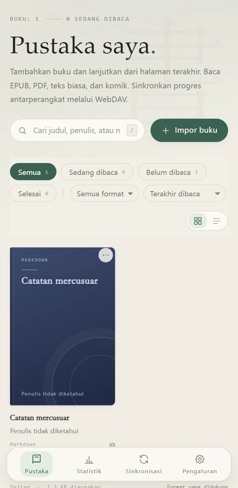
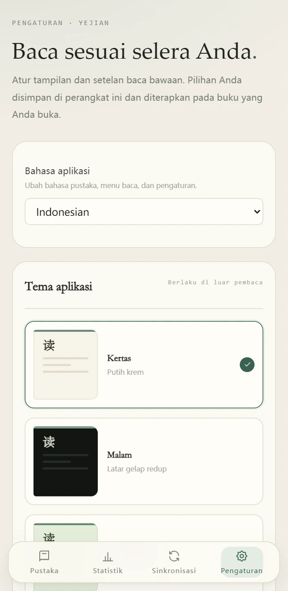

# Yejian (页间)

[简体中文](README.zh-CN.md) | [हिंदी](README.hi.md) | [Português](README.pt.md) | **Indonesian** | [English](README.md) | [Türkçe](README.tr.md)

[Situs proyek](https://itcwc.github.io/yejian-reader/?lang=id) · [Rilis terbaru](https://github.com/itcwc/yejian-reader/releases/latest)

Yejian adalah aplikasi baca gratis dan bersumber terbuka yang menyimpan pustaka di perangkat. Baca secara luring tanpa akun, atau gunakan server WebDAV sendiri untuk menyinkronkan buku dan progres membaca.

## Tangkapan layar

Saat pertama membuka aplikasi Android, pilih bahasa. Anda dapat mengubahnya di **Pengaturan → Bahasa aplikasi**.

<p align="center">
  
  
  
</p>

## Fitur

- Buka EPUB, PDF, TXT, Markdown, RTF, FB2, HTML, DOCX, dan CBZ/CBT secara langsung.
- Baca per halaman atau gulir terus-menerus. Atur jenis dan ukuran huruf, spasi baris, serta lebar teks.
- Pilih tema kertas, malam, atau hijau lembut. Posisi baca terakhir tersimpan di perangkat.
- Ekspor cadangan buku, sampul, dan progres, atau sinkronkan melalui WebDAV.

## Unduh dan pasang

Pilih berkas perangkat Anda di halaman [rilis terbaru](https://github.com/itcwc/yejian-reader/releases/latest).

- **Windows** — pemasang `.exe` 64-bit. Pilih bahasa Indonesia atau salah satu dari enam bahasa sebelum pemasangan dimulai.
- **Android** — `.apk` bertanda tangan untuk Android 7.0 atau yang lebih baru. Layar pemasangan mengikuti bahasa sistem ponsel.

Untuk beralih dari APK debug, buka **Pengaturan → Cadangan pustaka dan progres → Ekspor** (设置 → 书库与进度备份 → 导出备份) di aplikasi lama. Simpan berkas `.yejianbackup` di folder Unduhan atau penyimpanan awan. Hapus aplikasi lama, pasang APK baru, lalu impor cadangan dari panel yang sama. Atur ulang preferensi aplikasi dan WebDAV. [Panduan migrasi](.github/release-notes/v0.1.21.md)

## Jalankan versi web

[Buka Yejian di peramban](https://itcwc.github.io/yejian-reader/app/?lang=id), atau gunakan Node.js 18 atau lebih baru dan jalankan perintah berikut dari direktori utama repositori:

```bash
npm install
npm run dev
```

Buka `http://localhost:5180`. Untuk membuat build produksi dan memeriksanya secara lokal:

```bash
npm run build
npm run preview
```

### Publikasikan versi web

Setelah menjalankan `npm run build`, unggah isi `dist/` ke hosting web statis. Di repositori ini, [alur kerja GitHub Pages](.github/workflows/pages.yml) menerbitkan situs dan pembaca web sekaligus. Untuk sinkronisasi WebDAV di peramban, aktifkan CORS pada server atau gunakan reverse proxy dengan origin yang sama. `npm run dev` dan `npm run preview` menyediakan proxy lokal `/__dav`.

### Buat paket Windows x64

```bash
npm run pc
npm run build:pc
```

Perintah pertama membuka aplikasi di Electron. Perintah kedua membuat pemasang x64 di `release/`. Jika unduhan Electron dilewati saat pemasangan, jalankan `npm rebuild electron`.

### Buat paket Android

```bash
npm run build:android
```

Perintah ini membangun versi web dan menyalin aset ke kedua proyek Android. Untuk paket sendiri, impor `android-uniapp` di HBuilderX, lalu atur nama aplikasi, ID paket, dan tanda tangan. [Alur kerja rilis](.github/workflows/release.yml) menggunakan Android SDK dan Gradle untuk membuat APK bertanda tangan dari `android-webview`.

### WebDAV

Pada halaman **Sinkronisasi**, isi URL server, nama pengguna, kata sandi aplikasi, dan nama perangkat. Uji koneksi sebelum menyinkronkan. Aktifkan sinkronisasi berkas buku jika Anda ingin menyinkronkan buku bersama metadata dan progres. Untuk akses dari peramban, server WebDAV harus mengizinkan `PROPFIND`, `MKCOL`, dan `PUT`.

## Lisensi

Beberapa format memerlukan konversi dan berkas berpelindung DRM tidak didukung. Lihat [dokumentasi bahasa Inggris](README.md) untuk detailnya.

[Lisensi MIT](LICENSE) · [Laporkan masalah](https://github.com/itcwc/yejian-reader/issues)
