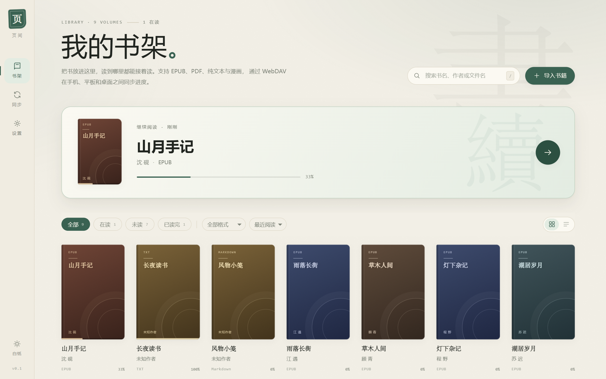
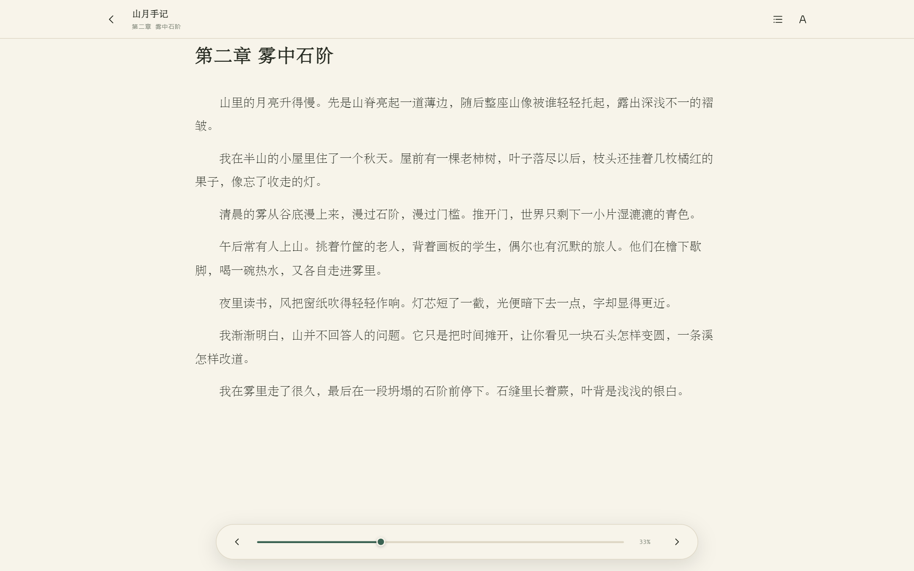
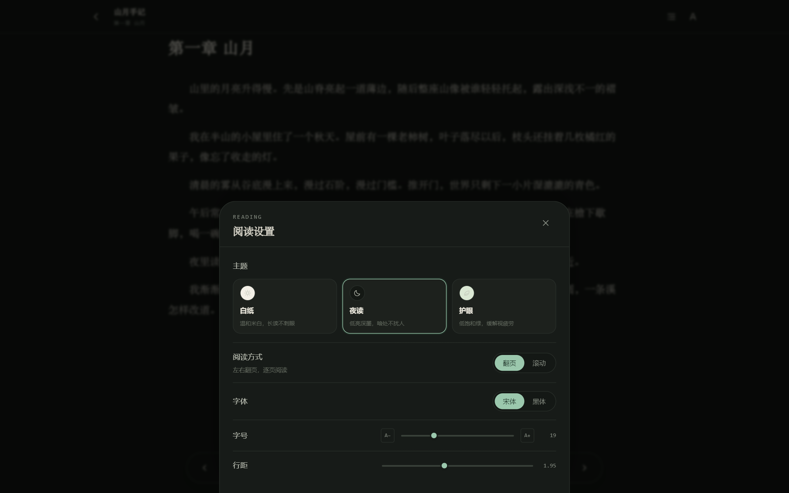
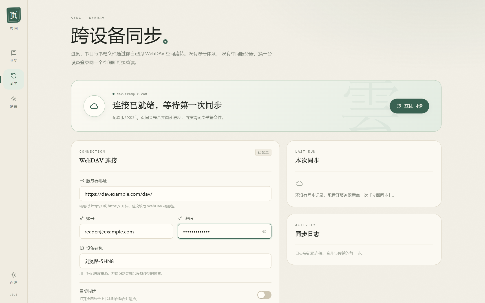
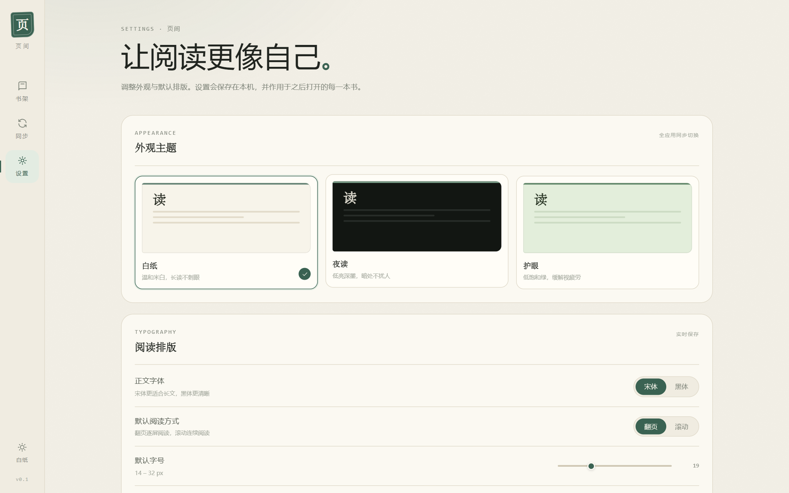
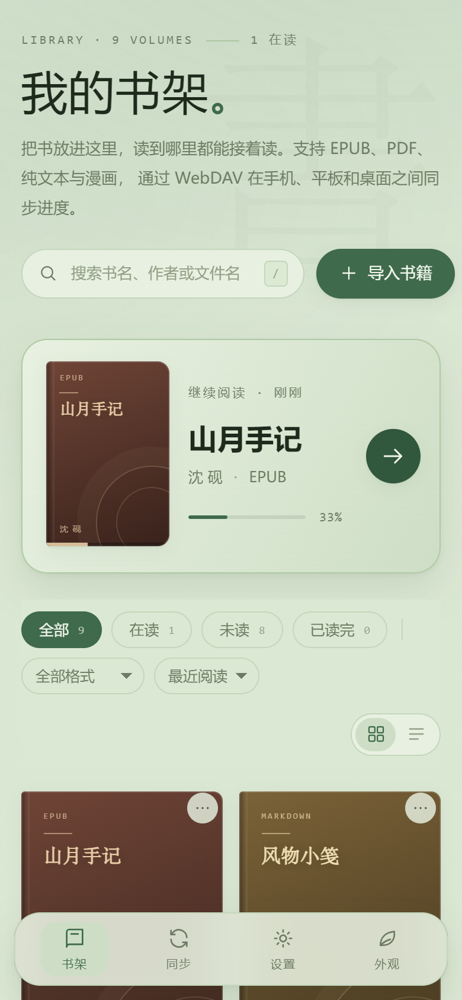
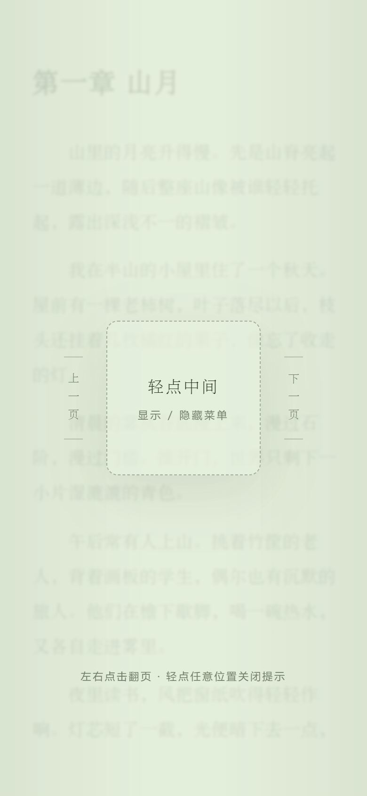

# 页间 · Yejian

简体中文 | [English](README.en.md)

[](LICENSE)
[](https://vuejs.org/)
[](https://vite.dev/)
[](https://www.typescriptlang.org/)
[](https://www.electronjs.org/)
[](https://uniapp.dcloud.net.cn/)

> 本地优先的跨设备阅读器。书架、书籍与阅读进度都留在你自己的设备与 WebDAV 空间里，没有账号体系，没有中间服务器。

页间覆盖 **Web / Windows / Android**：浏览器里即开即读，桌面端用 Electron 打包，移动端用 uni-app 承载同一套阅读内核。所有解析都在本地完成，联网只发生在你主动配置的 WebDAV 同步。

## 界面预览

### 桌面

<p align="center">
  
  
</p>
<p align="center">
  
  
</p>
<p align="center">
  
</p>

### 移动端

<p align="center">
  
  
</p>

> 截图使用演示书籍与占位账号，未包含真实书籍或凭据。

## 特性

- **多格式阅读**：EPUB、PDF、TXT、Markdown、RTF、FB2、HTML/XHTML/XML/MHTML、CBZ/CBT、DOCX 直接打开；Kindle、CHM、DjVu、OFD、CAJ 等格式识别后给出转换指引。
- **两种阅读方式**：逐屏翻页与连续滚动，文本、EPUB、PDF、漫画全部支持，切换时保留位置。
- **克制的交互**：点击屏幕左右翻页，点击中央正方形唤起/收起工具栏，首次进入有一次性热区引导。
- **三种主题**：白色（paper）、黑色（night）、护眼绿（green），阅读器、目录、设置面板同步换色。
- **排版可调**：字号、行距、版心宽度、衬线/无衬线字体；PDF 夜读反色与护眼滤镜；漫画单页/双页。
- **进度永不丢**：IndexedDB 本地持久化，退出、刷新、切页都会保存，重开自动续读。
- **WebDAV 同步**：书目、阅读进度、书籍文件都可同步；按 `updatedAt` 合并进度，换设备后直接接着读。
- **桌面与移动**：Electron 桌面壳、uni-app Android 壳共用同一份构建产物。

## 格式支持

| 类别 | 直接阅读 | 需要转换 |
| --- | --- | --- |
| 电子书 | EPUB、PDF、FB2 | MOBI、AZW、AZW3 → EPUB |
| 纯文本 | TXT、Markdown、RTF | — |
| 网页 | HTML、HTM、XHTML、XML、MHTML、MHT | CHM → EPUB / HTML |
| 漫画 | CBZ、CBT | CBR、CB7 → CBZ |
| 文档 | DOCX | DOC、PPT、PPTX、XPS、OXPS、DjVu、DJV、OFD → PDF / DOCX |
| 学术 | — | CAJ → PDF（导入时给出转换指引） |

> 转换工具推荐：Calibre（MOBI/AZW3/CHM）、7-Zip（CBR/CB7/CHM）、DjVuLibre、CAJViewer、WPS / Office。页间不内置转换器，也不上传你的文件。

## 下载安装

在 [Releases](https://github.com/itcwc/yejian-reader/releases) 获取：

- **Windows**：`Setup.0.1.0.exe`（NSIS 安装包，安装后应用名为「页间阅读」）
- **Android**：`yejian-v0.1.0-android-debug.apk`（debug 签名，允许「未知来源」后可直接安装）

APK 由 CI 使用原生 WebView 壳构建，离线书库与阅读功能完整；需要自定义包名、签名或上架应用商店时，用 HBuilderX 导入 `android-uniapp` 自行打包。

## 快速开始

要求 Node.js 18+。

```bash
npm install
npm run dev          # Web 开发服务器，默认 http://localhost:5180
```

```bash
npm run build        # 构建 Web 静态产物到 dist/
npm run preview      # 预览构建产物（含 WebDAV 同源代理）
```

### Windows 桌面端

```bash
npm run pc           # 构建并用 Electron 启动
npm run build:pc     # 打包安装程序到 release/
```

若 Electron 二进制未下载成功，先执行 `npm rebuild electron`。

### Android

```bash
npm run build:android   # 构建并复制 Web 产物到 android-uniapp 与 android-webview
```

- **直接安装**：从 Releases 下载 CI 构建的 debug APK。
- **自行打包**：用 HBuilderX 导入 `android-uniapp`，配置应用名称、包名与签名后打包；应用内通过 `web-view` 加载本地 `hybrid/html/index.html`。
- **CI 构建 APK**：`android-webview` 是原生 WebView 壳，由 `.github/workflows/release.yml` 使用 Android SDK 构建并上传 Release。

## 配置 WebDAV 同步

打开「同步」页，填写：

| 字段 | 示例 |
| --- | --- |
| 服务器地址 | `https://dav.jianguoyun.com/dav/` |
| 账号 | 坚果云邮箱 |
| 密码 | 应用专用密码 |
| 设备名称 | 用于标记进度来源 |

- 先点「测试连接」，通过后再「立即同步」。
- 打开「同步书籍文件」后，其他设备可直接下载书籍本体；关闭则只同步书目与进度。
- 云端目录：`yejian/books.json`、`yejian/progress.json`、`yejian/books/<id>.<ext>`。

### 关于 CORS

浏览器直连 WebDAV 需要服务端允许跨域（`PROPFIND`、`MKCOL`、`PUT` 等）。`npm run dev` 与 `npm run preview` 内置了 `/__dav` 同源代理，可自动绕过 CORS；纯静态部署或 Android WebView 中请在 WebDAV 服务端配置 CORS，或使用反向代理。

自建 Nginx WebDAV 时注意：

```nginx
location ^~ /dav/ {
    alias /www/wwwroot/your-site/dav/;   # location 与 alias 都要带结尾斜杠
    dav_methods PUT DELETE MKCOL COPY MOVE;
    dav_ext_methods PROPFIND OPTIONS;    # 需要 nginx-dav-ext-module
    create_full_put_path on;
    dav_access user:rw group:rw all:r;
    client_max_body_size 0;
}
```

目录属主需为 Nginx 运行用户（如 `www`），否则 `MKCOL` 会失败。

## 项目结构

```
src/
  core/          # IndexedDB、格式注册、元数据/封面、文本解析、WebDAV、同步
  readers/       # EPUB / PDF / 流式文本 / 漫画 / HTML 阅读引擎
  views/         # 书架、阅读器、同步、设置
  components/    # 书架卡片、导航、弹层、Toast 等
  stores/        # Pinia：书架、偏好、同步、提示
  styles/        # 三主题设计变量与基础样式
electron/        # 桌面主进程与 preload
android-uniapp/  # uni-app 壳（HBuilderX 打包，web-view 加载 hybrid 产物）
android-webview/ # 原生 WebView 壳，CI 用于直接产出 APK
scripts/         # 构建产物同步到 Android hybrid 目录
```

数据层使用 IndexedDB（`yejian`）：`books`、`files`、`covers`、`progress` 四个 store。书籍指纹取文件前 1MB 的 SHA-256 与文件大小，跨设备稳定，用于避免重复导入与对齐云端文件。

同步顺序：读取云端书目 → 下载缺失书籍 → 合并阅读进度（按 `updatedAt` 取新） → 回写书目与进度。先下载再合并，保证新设备上的进度能落到已下载的书上。

## 快捷键

| 按键 | 作用 |
| --- | --- |
| `←` / `→` / `↑` / `↓` | 上一页 / 下一页（滚动模式下上下滚动） |
| `PageUp` / `PageDown` / `Space` | 翻页 |
| `T` | 打开/关闭目录 |
| `S` | 打开/关闭排版设置 |
| `Esc` | 关闭面板 |

## 已知限制

- 需要转换的格式只提供指引，不内置转换器；CAJ 需先用 CAJViewer 导出 PDF。
- 浏览器直连 WebDAV 受 CORS 限制，静态部署需服务端配合。
- 大体积 PDF / 漫画首次打开需要解码时间；PDF 滚动模式按可视区域懒渲染。
- 加密 EPUB（DRM）、加密 PDF 不在支持范围内。

## 参与贡献

欢迎 Issue 与 Pull Request。提交前请确保 `npm run build` 通过，并尽量附上复现步骤与样例文件格式（无需上传受版权保护的正文）。

## 许可证

[MIT](LICENSE) © 2026 Yejian Contributors
