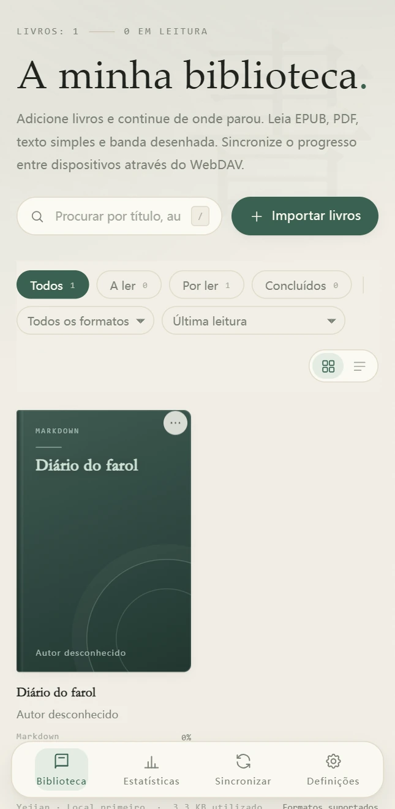
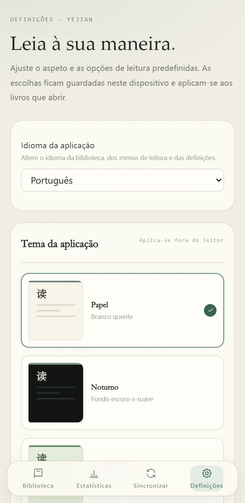

# Yejian (页间)

[简体中文](README.zh-CN.md) | [हिंदी](README.hi.md) | **Português** | [Indonesian](README.id.md) | [English](README.md) | [Türkçe](README.tr.md)

[Site do projeto](https://itcwc.github.io/yejian-reader/?lang=pt) · [Versão mais recente](https://github.com/itcwc/yejian-reader/releases/latest)

O Yejian é um leitor gratuito e de código aberto que guarda a biblioteca no dispositivo. Pode ler offline sem criar conta e sincronizar livros e progresso através do seu próprio servidor WebDAV.

## Capturas de ecrã

Ao abrir a aplicação Android pela primeira vez, escolha o idioma. Para o alterar mais tarde, abra **Definições → Idioma da aplicação**.

  
  
  

## Funcionalidades

- Abra diretamente EPUB, PDF, TXT, Markdown, RTF, FB2, HTML, DOCX e CBZ/CBT.
- Leia página a página ou com deslocamento contínuo. Ajuste o tipo e o tamanho de letra, o espaçamento entre linhas e a largura do texto.
- Escolha entre os temas papel, noturno ou verde suave. O leitor guarda a sua posição no livro.
- Exporte uma cópia local dos livros, capas e progresso ou sincronize via WebDAV.

## Transferência e instalação

Na [versão mais recente](https://github.com/itcwc/yejian-reader/releases/latest), transfira o ficheiro correspondente ao seu dispositivo.

- **Windows** — instalador `.exe` de 64 bits. Selecione português ou outro dos seis idiomas antes de iniciar a instalação.
- **Android** — `.apk` assinado para Android 7.0 ou posterior. O instalador do sistema utiliza o idioma do telemóvel.

Ao migrar de um APK de depuração, abra **Definições → Cópia de segurança da biblioteca e do progresso → Exportar** (设置 → 书库与进度备份 → 导出备份) na aplicação antiga. Guarde o ficheiro `.yejianbackup` em Transferências ou na nuvem. Desinstale a aplicação antiga, instale o APK atual e importe o ficheiro no mesmo painel. Configure novamente as preferências e o WebDAV. [Instruções de migração](.github/release-notes/v0.1.21.md)

## Desenvolvimento e licença

Com Node.js 18 ou posterior, execute `npm install` e `npm run dev`. Use `npm run build` para compilar para produção. Alguns formatos exigem conversão e os ficheiros protegidos por DRM não são suportados. Consulte a [documentação em inglês](README.md).

[Licença MIT](LICENSE) · [Comunicar um problema](https://github.com/itcwc/yejian-reader/issues)
