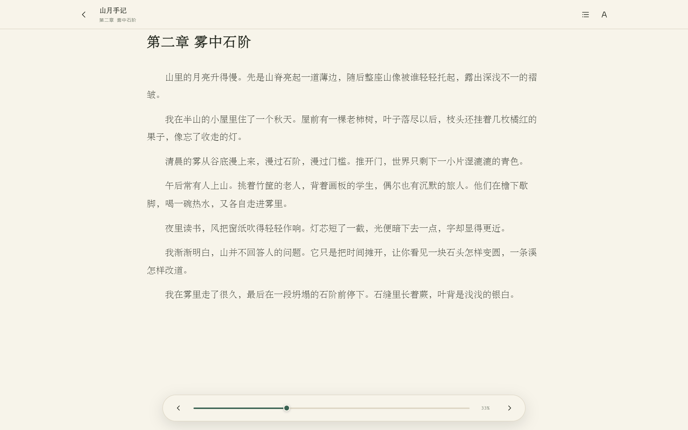

# Yejian (页间)

[简体中文](README.zh-CN.md) | [हिंदी](README.hi.md) | [Português](README.pt.md) | [Indonesian](README.id.md) | [English](README.md) | **Türkçe**

[Proje sitesi](https://itcwc.github.io/yejian-reader/?lang=tr) · [Son sürüm](https://github.com/itcwc/yejian-reader/releases/latest)

Yejian, kitaplığınızı cihazınızda saklayan ücretsiz ve açık kaynaklı bir okuyucudur. Hesap açmadan çevrimdışı okuyabilir, kitapları ve okuma ilerlemesini kendi WebDAV sunucunuzla eşitleyebilirsiniz.

## Özellikler

- EPUB, PDF, TXT, Markdown, RTF, FB2, HTML, DOCX ve CBZ/CBT dosyalarını doğrudan açın.
- Sayfa çevirerek veya sürekli kaydırarak okuyun. Yazı tipini, boyutunu, satır aralığını ve metin genişliğini ayarlayın.
- Kâğıt, gece veya açık yeşil temayı seçin. Okuyucu kitapta kaldığınız yeri saklar.
- Kitapları, kapakları ve okuma ilerlemesini yerel olarak yedekleyin ya da WebDAV ile eşitleyin.

## İndirme ve kurulum

[Son sürüm](https://github.com/itcwc/yejian-reader/releases/latest) sayfasından cihazınıza uygun dosyayı indirin.

- **Windows** — 64 bit `.exe` yükleyicisi. Kurulum başlamadan önce Türkçe dahil altı dilden birini seçin.
- **Android** — Android 7.0 ve üzeri için imzalı `.apk`. Kurulum ekranı telefonun sistem dilini kullanır.

Hata ayıklama APK’sından geçiyorsanız eski uygulamada **Ayarlar → Kitaplık ve okuma ilerlemesi yedeği → Dışa aktar** (设置 → 书库与进度备份 → 导出备份) seçeneğini açın. `.yejianbackup` dosyasını İndirilenler klasörüne veya buluta kaydedin. Eski uygulamayı kaldırın, yeni APK’yı kurun ve aynı panelden yedeği içe aktarın. Uygulama tercihlerini ve WebDAV’ı yeniden yapılandırın. [Geçiş adımları](.github/release-notes/v0.1.21.md)

## Geliştirme ve lisans

Node.js 18 veya üzeriyle `npm install` ve `npm run dev` komutlarını çalıştırın. Üretim derlemesi için `npm run build` kullanın. Bazı biçimler dönüştürme gerektirir ve DRM korumalı dosyalar desteklenmez. Ayrıntılar için [İngilizce belgelere](README.md) bakın.

[MIT lisansı](LICENSE) · [Sorun bildirin](https://github.com/itcwc/yejian-reader/issues)
