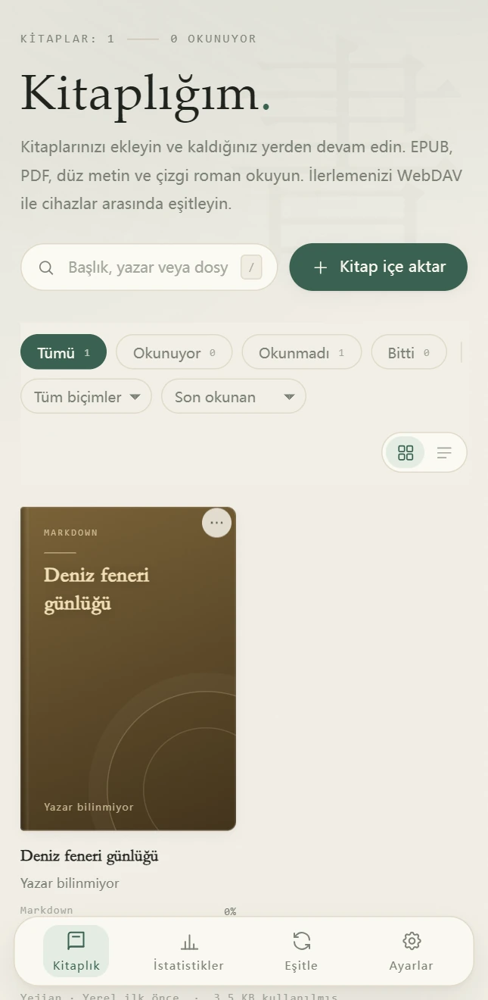

# Yejian (页间)

[简体中文](README.zh-CN.md) | [हिंदी](README.hi.md) | [Português](README.pt.md) | [Indonesian](README.id.md) | [English](README.md) | **Türkçe**

[Proje sitesi](https://itcwc.github.io/yejian-reader/?lang=tr) · [Son sürüm](https://github.com/itcwc/yejian-reader/releases/latest)

Yejian, kitaplığınızı cihazınızda saklayan ücretsiz ve açık kaynaklı bir okuyucudur. Hesap açmadan çevrimdışı okuyabilir, kitapları ve okuma ilerlemesini kendi WebDAV sunucunuzla eşitleyebilirsiniz.

## Ekran görüntüleri

Android uygulamasını ilk açtığınızda dilinizi seçin. Daha sonra **Ayarlar → Uygulama dili** bölümünden değiştirebilirsiniz.

<p align="center">
  
  
  
</p>

## Özellikler

- EPUB, PDF, TXT, Markdown, RTF, FB2, HTML, DOCX ve CBZ/CBT dosyalarını doğrudan açın.
- Sayfa çevirerek veya sürekli kaydırarak okuyun. Yazı tipini, boyutunu, satır aralığını ve metin genişliğini ayarlayın.
- Kâğıt, gece veya açık yeşil temayı seçin. Okuyucu kitapta kaldığınız yeri saklar.
- Kitapları, kapakları ve okuma ilerlemesini yerel olarak yedekleyin ya da WebDAV ile eşitleyin.

## Desteklenen biçimler

| Kategori | Doğrudan açılır | Dönüştürme gerekir |
| --- | --- | --- |
| E-kitap | EPUB, PDF, FB2 | MOBI, AZW, AZW3 → EPUB |
| Düz metin | TXT, Markdown, RTF | — |
| Web | HTML, HTM, XHTML, XML, MHTML, MHT | CHM → EPUB / HTML |
| Çizgi roman | CBZ, CBT | CBR, CB7 → CBZ |
| Belgeler | DOCX | DOC, PPT, PPTX, XPS, OXPS, DjVu, DJV, OFD → PDF / DOCX |
| Akademik | — | CAJ → PDF (içe aktarırken yönergeler gösterilir) |

Dosyaları dönüştürmek için Calibre, 7-Zip, DjVuLibre, CAJViewer veya WPS/Office kullanılabilir. (Calibre (MOBI/AZW3/CHM), 7-Zip (CBR/CB7/CHM), DjVuLibre, CAJViewer, WPS/Office).

## İndirme ve kurulum

[Son sürüm](https://github.com/itcwc/yejian-reader/releases/latest) sayfasından cihazınıza uygun dosyayı indirin.

- **Windows** — 64 bit `.exe` yükleyicisi. Kurulum başlamadan önce Türkçe dahil altı dilden birini seçin.
- **Android** — Android 7.0 ve üzeri için imzalı `.apk`. Kurulum ekranı telefonun sistem dilini kullanır.

Hata ayıklama APK’sından geçiyorsanız eski uygulamada **Ayarlar → Kitaplık ve okuma ilerlemesi yedeği → Dışa aktar** (设置 → 书库与进度备份 → 导出备份) seçeneğini açın. `.yejianbackup` dosyasını İndirilenler klasörüne veya buluta kaydedin. Eski uygulamayı kaldırın, yeni APK’yı kurun ve aynı panelden yedeği içe aktarın. Uygulama tercihlerini ve WebDAV’ı yeniden yapılandırın. [Geçiş adımları](.github/release-notes/v0.1.21.md)

### Uygulama içi güncellemeler

Windows ve Android uygulamaları açılışta güncellemeleri kontrol eder. Güncellemeyi uygulamadan indirin. Windows’ta kurulum için uygulamayı yeniden başlatın. Android’de uygulama APK’nın SHA-256 değerini doğrular ve sistem yükleyicisini açar.

## Web sürümünü çalıştırma

[Yejian’ı tarayıcıda açın](https://itcwc.github.io/yejian-reader/app/?lang=tr) veya Node.js 18 ya da üzeriyle depo kök dizininde şu komutları çalıştırın:

```bash
npm install
npm run dev
```

`http://localhost:5180` adresini açın. Üretim derlemesini oluşturmak ve yerel olarak önizlemek için:

```bash
npm run build
npm run preview
```

### Web sürümünü yayımlama

`npm run build` komutundan sonra `dist/` içeriğini statik web barındırma hizmetinize yükleyin. Bu depodaki [GitHub Pages iş akışı](.github/workflows/pages.yml) tanıtım sitesini ve web okuyucusunu birlikte yayımlar. Tarayıcıda WebDAV eşitlemesi için sunucuda CORS’a izin verin veya aynı kökende bir ters vekil kullanın. `npm run dev` ve `npm run preview`, yerel `/__dav` vekilini içerir.

### Windows x64 paketleme

```bash
npm run pc
npm run build:pc
```

İlk komut uygulamayı Electron ile açar. İkinci komut x64 yükleyicisini `release/` dizinine oluşturur. Kurulumda Electron indirilmediyse `npm rebuild electron` komutunu çalıştırın.

### Android paketleme

```bash
npm run build:android
```

Bu komut web sürümünü derler ve dosyaları iki Android projesine kopyalar. Kendi paketinizi oluşturmak için `android-uniapp` projesini HBuilderX’e aktarın ve uygulama adını, paket kimliğini ve imzasını ayarlayın. [Sürüm iş akışı](.github/workflows/release.yml), Android SDK ve Gradle ile `android-webview` projesinden imzalı APK üretir.

### WebDAV

**Eşitle** sayfasına sunucu adresini, kullanıcı adını, uygulama parolasını ve cihaz adını girin. Eşitlemeden önce bağlantıyı test edin. Meta veriler ve ilerlemeyle birlikte kitap dosyalarını da aktarmak için dosya eşitlemesini açın. Tarayıcı erişimi için WebDAV sunucusu `PROPFIND`, `MKCOL` ve `PUT` yöntemlerine izin vermelidir.

Sunucudaki dizin yapısı: `yejian/books.json`, `yejian/progress.json`, `yejian/books/<id>.<ext>`.

### Nginx WebDAV örneği

WebDAV’ı kendi Nginx sunucunuzda barındırmak için bu örneği kullanın.

```nginx
location ^~ /dav/ {
    alias /www/wwwroot/your-site/dav/;
    dav_methods PUT DELETE MKCOL COPY MOVE;
    dav_ext_methods PROPFIND OPTIONS;
    create_full_put_path on;
    dav_access user:rw group:rw all:r;
    client_max_body_size 0;
}
```

Her iki yolun sonundaki eğik çizgiyi koruyun. `PROPFIND` için `nginx-dav-ext-module` gerekir. Nginx kullanıcısına bu dizin için yazma izni verin. Bu örnek WebDAV depolamasını yapılandırır. Web okuyucu farklı bir kökendeyse CORS’u da yapılandırın.

## Kitaplığı ve okuma ilerlemesini çevrimdışı aktarma

Eski cihazda **Ayarlar → Kitaplık ve ilerleme yedeği → Dışa aktar** seçeneğini açın. `.yejianbackup` dosyasını yeni cihaza kopyalayıp aynı panelden içe aktarın. Yedek, kitapların orijinallerini, kapakları ve okuma konumlarını içerir. İçe aktarma eksik kitapları ekler ve her kitap için en son okuma konumunu korur.

## Klavye kısayolları

| Tuş | İşlem |
| --- | --- |
| `←` / `→` / `↑` / `↓` | Önceki veya sonraki sayfa (sürekli modda kaydırma) |
| `PageUp` / `PageDown` / `Space` | Sayfa çevir |
| `T` | İçindekileri göster veya gizle |
| `S` | Tipografi ayarlarını göster veya gizle |
| `Esc` | Panelleri kapat |

## Proje yapısı

`src` web arayüzünü ve okuyucuları içerir. `electron` masaüstü uygulamasıdır. `android-webview` resmî APK için, `android-uniapp` HBuilderX içindir. Veriler IndexedDB’de tutulur. WebDAV eşitlemesi önce eksik kitapları indirir, ardından en güncel okuma konumlarını birleştirir.

## Sınırlamalar

Bazı biçimleri önce dönüştürmek gerekir. CAJ dosyalarını CAJViewer ile PDF olarak dışa aktarın. Büyük PDF ve çizgi romanlar ilk açılışta zaman alabilir. DRM korumalı EPUB ve PDF dosyaları desteklenmez.

## Katkıda bulunma

Sorun bildirimleri ve pull request’ler memnuniyetle karşılanır. `npm run build` komutunu çalıştırın, sorunu yeniden oluşturma adımlarını ve dosya biçimini belirtin.

## Lisans

[MIT lisansı](LICENSE) · [Sorun bildirin](https://github.com/itcwc/yejian-reader/issues)
